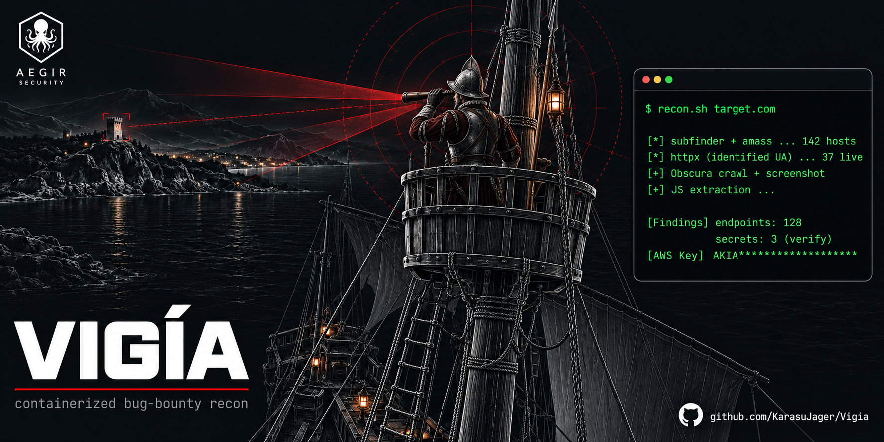

# Vigía

> *El vigía otea desde la cofa y avisa de lo que aparece en el horizonte.*

Containerized, reproducible **bug-bounty recon + JS deep analysis**. Point it at
an in-scope root domain and get back: a browsable report with full-page
screenshots, endpoints and secrets from JavaScript, **plus a deep JS analysis**
with sink detection, hidden parameters, API routes, and vulnerable library
identification — all in a single command.

**Pipeline:**

```
subfinder + amass (passive)
  → httpx (probing)
  → headless browser via CDP (crawl + screenshot + JS download)
  → JS Deep Analysis (6 tools):
      1. js-beautify  — desminify
      2. built-in     — sinks, postMessage, auth flows, client-only validations, hidden params
      3. LinkFinder   — endpoint extraction
      4. SecretFinder — secret/token detection
      5. RetireJS     — vulnerable library detection
      6. JSLuice      — deep URL/secret/syntax-tree analysis
  → HTML triage report + structured analysis output
```

---

## Why this over the usual `screenshot` scripts

- **It renders JavaScript.** A plain `curl`/`wget` sees an empty `<div id="root">`.
  Vigía drives a real headless browser over CDP, so it extracts API routes, hidden
  endpoints and secrets from the JS of heavy SPAs (React/Vue) — exactly where a lot
  of *info-disclosure* and *leaked-key* findings live.
- **Deep JS analysis built-in.** Beyond simple regex extraction, Vigía runs 6 analysis
  tools on every downloaded JS file: it finds dangerous sinks (innerHTML, eval,
  postMessage without origin check), hidden API routes, client-only validations that
  can be bypassed, and known-vulnerable libraries.
- **Traffic is identified by default.** Every request carries a `User-Agent` and an
  `X-Bug-Bounty` header with your researcher handle. Many programs *require*
  identified traffic; Vigía complies out of the box.
- **No stealth, no evasion.** It deliberately runs **without** anti-detection flags.
  This is a tool for *authorized* testing.
- **Reproducible and unattended.** One command, fully containerized. Each run is
  timestamped; `latest` always points to the newest.

## Stack

| Layer | Tool |
|-------|------|
| Passive subdomain enum | [`subfinder`](https://github.com/projectdiscovery/subfinder) + [`amass`](https://github.com/owasp-amass/amass) |
| Live-host probing | [`httpx`](https://github.com/projectdiscovery/httpx) |
| Render / screenshot / crawl | [Obscura](https://hub.docker.com/r/h4ckf0r0day/obscura) — headless Chromium via CDP, renders SPAs, takes full-page screenshots, intercepts all network resources |
| Basic extraction | LinkFinder-style endpoint regex + secret patterns |
| JS desminification | [jsbeautifier](https://pypi.org/project/jsbeautifier/) |
| Endpoint extraction | [LinkFinder](https://github.com/dark-warlord14/LinkFinder) |
| Secret detection | [SecretFinder](https://github.com/m4ll0k/SecretFinder) |
| Vulnerable libraries | [RetireJS](https://retirejs.github.io/retire.js/) |
| Deep JS analysis | [JSLuice](https://github.com/BishopFox/jsluice) (compiled via multi-stage Docker build) |
| Report | self-contained dark-theme `index.html` |

## Setup

```bash
git clone https://github.com/KarasuJager/vigia.git
cd vigia

cp .env.example .env          # set HANDLE (your researcher handle), tune throttling
docker compose build          # first build ~5-8 min (compiles JSLuice + downloads tools)
docker compose up -d obscura
```

## Run

```bash
# put your IN-SCOPE roots in a file under scope/ (one domain per line)
echo "target.com" > scope/target.txt

# run everything: recon + JS deep analysis
docker compose run --rm recon /scope/target.txt
```

Open the report:

```bash
# macOS/Linux
open  data/target/latest/index.html
# Windows (PowerShell)
start data\target\latest\index.html
```

## Output

```
data/<program>/<timestamp>/
├── subs.txt              all discovered subdomains
├── alive.txt             httpx output (status, title, tech, ip, content-length)
├── alive_urls.txt        live URLs
├── screenshots/*.png     full-page screenshots
├── crawl/<host>.json     links, scripts and every resource the page requested
├── findings/
│   ├── endpoints.txt      endpoints mined from JS  (-> feed into Burp)
│   ├── secrets.txt        potential secrets — verify manually
│   ├── js-raw/            raw JS files downloaded from the target
│   └── js-analysis/       deep JS analysis output:
│       ├── beautified/        desminified JS (readable)
│       ├── builtin-analysis.txt   sinks, auth flows, hidden params, API routes
│       ├── api-routes.txt     API endpoints found in JS
│       ├── hidden-params.txt  potential hidden parameters
│       ├── linkfinder.txt     LinkFinder results
│       ├── secretfinder.txt   SecretFinder results
│       ├── retirejs.json      vulnerable libraries
│       └── jsluice.json       JSLuice URLs + secrets
└── index.html            visual triage report
data/<program>/latest  ->  symlink to the newest run
```

### What the JS analysis finds

| Category | What it detects | Why it matters |
|----------|----------------|----------------|
| **XSS sinks** | innerHTML, eval, document.write, dangerouslySetInnerHTML, v-html, jQuery .html() | Direct XSS vectors |
| **postMessage** | message listeners without origin checks | Cross-origin data theft |
| **Prototype pollution** | \_\_proto\_\_, Object.assign, lodash merge | RCE in Node.js, XSS in browser |
| **Redirect sinks** | location.href, location.replace, window.open with variables | Open redirect chains |
| **Fetch sinks** | fetch/axios/XHR with variable URLs | SSRF vectors |
| **Auth flows** | Token storage, authorization headers, OAuth patterns, cookie manipulation | Auth bypass opportunities |
| **Client-only validation** | Disabled fields, readonly toggles, client-side role checks | Bypass from Burp |
| **Hidden parameters** | debug, test, admin, internal, force, bypass params in JS | Undocumented functionality |
| **API routes** | /api/, /v1/, /internal/, /admin/, /private/ paths in JS | Shadow API surface |
| **Vulnerable libraries** | Known CVEs in JS libraries (via RetireJS) | Known exploits |

## Tuning (`.env`)

| var | what | default |
|-----|------|---------|
| `HANDLE` | your researcher handle (sent to targets in UA + `X-Bug-Bounty`) | `your-handle` |
| `CONTACT` | optional contact appended to the User-Agent | *(empty)* |
| `CONCURRENCY` | parallel pages during crawl/screenshot | `5` |
| `REQ_DELAY_MS` | delay added per request | `400` |
| `NAV_TIMEOUT_S` | per-page navigation timeout | `25` |
| `HTTPX_RATELIMIT` | httpx requests/sec cap | `50` |
| `AMASS_ENABLED` | run amass passive too | `true` |
| `AMASS_TIMEOUT_MIN` | cap amass passive per root | `10` |

## Responsible use

Vigía is for **authorized security testing only** — bug-bounty programs whose scope
and policy explicitly allow you to test, or systems you own or have written
permission to assess. Before you point it at anything:

- **Confirm scope.** Only roots the program lists. `scope/*.txt` is the only input.
- **Read the program's automation policy.** Some restrict automated crawling/scanning.
- **Read your host's AUP.** Many VPS/cloud providers prohibit scanning traffic.
- **Keep your traffic identified** (that's the default) and **throttle** for fragile
  targets — lower `CONCURRENCY`, raise `REQ_DELAY_MS`.

You are responsible for how you use this tool. The author assumes no liability for
misuse or for any damage caused. See [`LICENSE`](LICENSE).

## Obscura — the rendering engine

Vigía uses [Obscura](https://hub.docker.com/r/h4ckf0r0day/obscura) as its headless
browser. Obscura runs a Chromium instance accessible over CDP (Chrome DevTools Protocol),
and Vigía's crawl driver connects to it via Playwright to:

- **Render JavaScript-heavy pages** (React, Vue, Angular SPAs) — sees the real DOM, not raw HTML
- **Take full-page screenshots** of every live host
- **Intercept all network resources** the page loads (JS, CSS, API calls, fonts, images)
- **Extract script sources** and link targets from the rendered page

Obscura runs as a separate Docker service (`docker compose up -d obscura`) and shares
its network namespace with the recon container, so CDP is reachable at `localhost:9222`
without exposing the port to the host.

## Design notes

- Obscura runs **without** `--stealth` and its CDP port is **not** published to the
  host. If you ever expose it, bind to `127.0.0.1` and set `OBSCURA_CDP_TOKEN`.
- JS files are fetched server-side with the **same identified UA/header** as the crawl.
- JSLuice is compiled from source in a multi-stage Docker build (Go 1.22) — no
  prebuilt binary needed.
- One-shot by design: every run is timestamped and independent.

---

Built by [Manuel Miguel Fernandez-Gallego Olivares](https://www.linkedin.com/in/manuel-miguel-olivares)
· Offensive Security Engineer · part of a small toolkit alongside
[SONDA](https://github.com/KarasuJager) (HTTP differential testing) and
bb-alert (new-program alerting).
