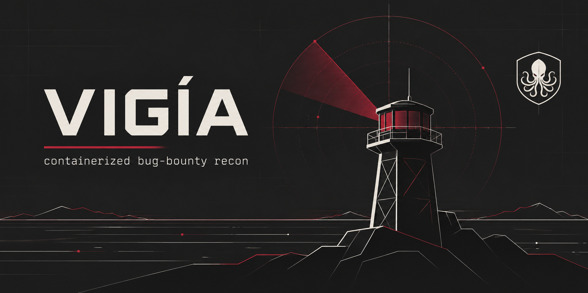

# Vigía

> *El vigía otea desde la cofa y avisa de lo que aparece en el horizonte.*

Containerized, reproducible **bug-bounty recon**. Point it at an in-scope root
domain and get back a browsable report: a full-page screenshot of every live
host, endpoints and potential secrets pulled out of JavaScript, and per-host
crawl data — ready to feed straight into Burp.

**Pipeline:** `subfinder + amass` (passive) → `httpx` → **headless browser via CDP**
→ JS endpoint/secret extraction → HTML triage report.

---

## Why this over the usual `screenshot` scripts

- **It renders JavaScript.** A plain `curl`/`wget` sees an empty `<div id="root">`.
  Vigía drives a real headless browser over CDP, so it extracts API routes, hidden
  endpoints and secrets from the JS of heavy SPAs (React/Vue) — exactly where a lot
  of *info-disclosure* and *leaked-key* findings live.
- **Traffic is identified by default.** Every request carries a `User-Agent` and an
  `X-Bug-Bounty` header with your researcher handle, and an optional contact. Many
  programs *require* identified traffic; Vigía complies out of the box instead of
  hiding behind a generic UA.
- **No stealth, no evasion.** It deliberately runs **without** anti-detection flags
  and is **not** exposed to the host. This is a tool for *authorized* testing, and
  it's built to look like authorized testing.
- **Reproducible and unattended.** One shot, fully containerized. Each run is
  timestamped; `latest` always points to the newest. Re-run on any new program in
  minutes.

## Stack

| Layer | Tool |
|-------|------|
| Passive subdomain enum | [`subfinder`](https://github.com/projectdiscovery/subfinder) + [`amass`](https://github.com/owasp-amass/amass) |
| Live-host probing | [`httpx`](https://github.com/projectdiscovery/httpx) |
| Render / screenshot / crawl | headless browser over CDP (Playwright client) |
| Extraction | LinkFinder-style endpoint regex + secret patterns (AWS, GCP, Slack, GitHub, Stripe, JWT, private keys…) |
| Report | self-contained dark-theme `index.html` |

## Setup

```bash
git clone https://github.com/KarasuJager/vigia.git
cd vigia

cp .env.example .env          # set HANDLE (your researcher handle), tune throttling
docker compose build          # first build ~3-5 min (downloads release binaries)
docker compose up -d obscura
```

## Run

```bash
# put your IN-SCOPE roots in a file under scope/ (one domain per line)
echo "target.com" > scope/target.txt

docker compose run --rm recon ./scripts/recon.sh /scope/target.txt target
```

Open the report:

```bash
# macOS/Linux
open  data/target/latest/index.html
# Windows (PowerShell)
start data\target\latest\index.html
```

## Output

```
data/<program>/<timestamp>/
├── subs.txt              all discovered subdomains
├── alive.txt             httpx output (status, title, tech, ip, content-length)
├── alive_urls.txt        live URLs
├── screenshots/*.png     full-page screenshots
├── crawl/<host>.json     links, scripts and every resource the page requested
├── findings/
│   ├── endpoints.txt      endpoints mined from JS  (→ feed into Burp)
│   └── secrets.txt        ⚠ potential secrets — expect false positives, verify manually
└── index.html            visual triage report
data/<program>/latest  →  symlink to the newest run
```

## Tuning (`.env`)

| var | what | default |
|-----|------|---------|
| `HANDLE` | your researcher handle (sent to targets in UA + `X-Bug-Bounty`) | `your-handle` |
| `CONTACT` | optional contact appended to the User-Agent | *(empty)* |
| `CONCURRENCY` | parallel pages during crawl/screenshot | `5` |
| `REQ_DELAY_MS` | delay added per request | `400` |
| `NAV_TIMEOUT_S` | per-page navigation timeout | `25` |
| `HTTPX_RATELIMIT` | httpx requests/sec cap | `50` |
| `AMASS_ENABLED` | run amass passive too | `true` |
| `AMASS_TIMEOUT_MIN` | cap amass passive per root | `10` |

## Responsible use

Vigía is for **authorized security testing only** — bug-bounty programs whose scope
and policy explicitly allow you to test, or systems you own or have written
permission to assess. Before you point it at anything:

- **Confirm scope.** Only roots the program lists. `scope/*.txt` is the only input.
- **Read the program's automation policy.** Some restrict automated crawling/scanning.
- **Read your host's AUP.** Many VPS/cloud providers prohibit scanning traffic.
- **Keep your traffic identified** (that's the default) and **throttle** for fragile
  targets — lower `CONCURRENCY`, raise `REQ_DELAY_MS`.

You are responsible for how you use this tool. The author assumes no liability for
misuse or for any damage caused. See [`LICENSE`](LICENSE).

## Design notes

- The headless browser runs **without** `--stealth` and is **not** published to the
  host. If you ever expose the CDP port, bind it to `127.0.0.1` and put a token on it.
- JS files are fetched server-side with the **same identified UA/header** as the crawl.
- One-shot by design: every run is timestamped and independent.

---

Built by [Manuel Miguel Fernández-Gallego Olivares](https://www.linkedin.com/in/manuel-miguel-olivares)
· Offensive Security Engineer · part of a small toolkit alongside
[SONDA](https://github.com/KarasuJager) (HTTP differential testing) and bb-alert
(new-program alerting).
